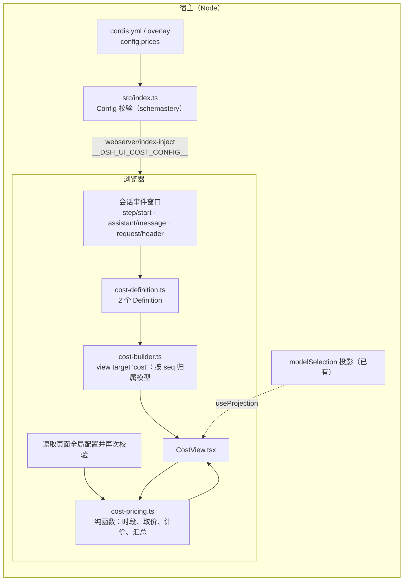

# 会话花费估算插件 技术方案

> Feature：999 | 有效需求来源：[PRD](../spec/PRD.md)（2026-11-14 修订，AC-01～AC-15） | Profile：standard | 模板：`mai-specs/_templates/TECH_DESIGN.tmpl.md` | 代码基线：`homework-1-build-plugin` @ `a9f6f7694f` | 状态：已按实现同步（2026-11-14）。依据[实现报告](../dev/IMPLEMENTATION_REPORT.md)的"与设计的偏差"（V-01～V-15）与"T9 核实 Q-02、Q-05"；[方案评审](../review/design_review.md)结论为有条件通过，P1 两项已在实现中落实（D-08、D-09）

[返回需求简报](../BRIEF.md) · [代码设计附录](CODE_DESIGN.md)

## 需求依据与验收

需求与 AC 以 [PRD](../spec/PRD.md) 为唯一维护源，本文只引用编号：FR-01～FR-08、BR-01～BR-07、NFR-01～NFR-03、AC-01～AC-15、文案 C-01～C-13、内置价目表（R-01）。

本方案对 PRD 的待确认事项和需回改处的处理：

| 编号 | 结论 | 依据 | 对 PRD 的影响 |
|---|---|---|---|
| Q-04（阻塞项） | **可行，有限制**。步骤开始时间取 `step/start` 事件的 `time`。模型 ID 不在 `assistant/message` 上，只在模型或请求头**变化时**记入 `request/header`（`header.config.model`），同一步内先于 `assistant/message` 写入。浏览器端取"该步 `assistant/message` 之前最近一条 `request/header`"的模型。窗口内没有任何 `request/header` 时，用宿主投影 `modelSelection.lastUsed`。窗口内有 header，但某步在第一条 header 之前时，推不出模型 | `packages/core/session/src/types.ts`（`SessionEventMap`）、`packages/core/agent-loop/src/agent.ts` `buildRequest()`、`packages/core/agent/src/model-selection.ts` | 推不出模型的步骤**计入未定价**（2026-11-11 用户决定 D-04），沿用 C-07、C-11，不新增文案 |
| Q-02 | **已解决**（2026-11-13，任务 T9）。DeepSeek 适配器把 `cache_creation_input_tokens` 映射为 `cacheWriteTokens`（`packages/llm/llm-deepseek/src/translate.ts`）；4 个真实会话共 109 个带用量的步骤中，该字段都存在且都为 0。BR-01 的写入规则保留，当前不影响计价结果 | [实现报告 T9](../dev/IMPLEMENTATION_REPORT.md#t9-核实-q-02q-05) | **已回写**（2026-11-14，PRD Q-02 与 BR-01 注） |
| Q-03 | 仓库测试 `scripts/locale-dictionary-parity.spec.ts` 要求对象形式词典注册全部 8 种已发布语言（`scripts/shipped-locales.ts`）。因此提供 zh、en、ja、de、es、fr、pt、ru 共 8 种 | 同左 | NFR-01 写的是"至少中英文"，8 种语言满足该要求，不需回改 |
| PRD UI-01"错误"状态 | **改为加载时报错**（2026-11-11 用户决定 D-05）。单价配置由 schemastery 校验，负数或非数字会让插件加载失败，并报出字段路径。这符合 AGENTS.md "Misconfiguration fails loud at load" | AGENTS.md Conventions | **已同步**（2026-11-11，PRD commit `195a9e7bed`）：PRD UI-01"错误"状态已改为"单价配置无效时插件加载失败并报出出错字段"，并新增 AC-15 |
| Q-01 | 按 BR-03 实现，不影响设计结构 | — | **已确认**（2026-11-13，PRD Q-01，测试计划 A-10） |
| Q-05（PRD 2026-11-13 新增，测试计划 A-08） | **已解决**（2026-11-13，任务 T9）。模型 ID 取自 `request/header` 的 `header.config.model`；真实会话中的实际值只有 `deepseek-flash`、`deepseek-v4-pro`，与 `BUILTIN_PRICES` 的键完全一致，相应步骤在 T8-1c、T8-5 中均已计价。不需要模型 ID 映射 | `packages/core/agent-loop/src/agent.ts` `buildRequest()`；[实现报告 T8、T9](../dev/IMPLEMENTATION_REPORT.md#t9-核实-q-02q-05) | **已回写**（2026-11-14，PRD Q-05） |
| V-13 空状态下的"加载更早" | 已加载窗口没有带用量的步骤、但会话还有更早轮次时，在 C-09 下方显示"加载更早"按钮，不显示 C-08（见 §2.3.2） | 实现报告 V-13；负责人 2026-11-13 接受 | **已回写**（2026-11-14，PRD UI-01 空状态与 AC-11） |
| BR-07 在 ¥1 附近的格式 | 0.99995 ≤ 金额 < 1 时，按 4 位四舍五入会得到 1.0000，因此改按 2 位显示为 `¥1.00`（[CODE_DESIGN §5](CODE_DESIGN.md#5-视图要点costviewtsx)） | 评审 P2-2；负责人于 2026-11-11 接受 | **已回写（PRD BR-07、AC-12）** |

## 1. 方案概述

### 1.1 设计目标和设计原则

- **用户路径**：启用插件，打开会话，切换到"花费"页签，查看合计卡与每轮明细（BF-01）。加载更早轮次后合计更新（FR-07）；新步骤完成后金额实时更新（FR-08）。
- **成功标准**：AC-01～AC-15。计价、时段、格式、合并模型等规则用纯函数单元测试覆盖（AC-02～AC-08、AC-11、AC-12）；配置校验用负例单元测试覆盖（AC-15）；页签可见、分页、实时更新、README，以及错误配置下的启动报错按人工步骤验收（AC-01、AC-09、AC-10、AC-14、AC-15）。
- **不做**：沿用 PRD 第 7 章"不包含"。另外，本方案**不计**压缩摘要调用和失败重试尝试消耗的 token（PRD 只定义了"步骤"花费），见风险 R3。
- **硬约束**：
  - 浏览器端只读取会话事件，不访问网络（NFR-02）。
  - 文案全部走语言包（NFR-01）。
  - 新增的 `cordis.yml` 配置字段经过校验，配置错误时加载即失败（AGENTS.md）。
  - 实验包只通过 `--patch` overlay 挂载，不进入已发布 profile。这与 `client-ui-stats` 相同（`apps/web/tests/client-ui-stats-panel.overlay.yml` 的注释说明了 default-product isolation）。
  - 新包 `src` 需达到逐文件 100% 覆盖率（`test:coverage`）。
- **复用**：
  - `client-ui-stats` 的页签注册、Conversation Definition 与 view target 模式。分页不照搬 stats，直接调用会话的 `loadOlder()`（D-08）。"加载更早"的文案与状态沿用 stats，按钮改用 `ui-primitives` 的共享 `Button`（`size="sm"`、`variant="outline"`），不复制 stats 的本地 `.button` 样式，因此外观与 stats 的按钮略有不同（实现报告 V-14）。
  - `ui-sidebar-documentpreview` 的"宿主入口通过 `webserver/index-inject` 把校验后的配置写进页面"模式。
  - 宿主投影 `modelSelection`。

### 1.2 整体架构

新增一个实验包，目录为 `packages/experimental/client-ui-cost`，包名为 `@deepseek-ai/dsh-client-ui-cost`。`packages/experimental/AGENTS.md` 禁止新包使用 `dsh-experimental-` 前缀，因此该包名登记在 `scripts/experimental-package-policy.ts` 的 `EXPERIMENTAL_PACKAGE_NAME_EXCEPTIONS` 中（用户 2026-11-13 指定，实现报告 V-01）。不修改现有包的源码，只在仓库注册表中登记。

| 部分 | 新增/复用 | 说明 |
|---|---|---|
| 宿主入口 `src/index.ts` + `src/config.ts` | 新增 | 只校验配置并写入页面全局变量。不注册服务、工具或 RPC，保持 NFR-02 的"不新增宿主服务" |
| Definitions + view builder | 新增，模式复用 stats | 把事件折叠成"计价步骤"和"路由变更"两类节点，在 builder 中按 seq 为每步确定模型 |
| 计价与格式 | 新增，纯函数 | BR-01～BR-07 的唯一实现位置 |
| 视图 | 新增，交互复用 stats | 合计卡、部分加载提示、明细表、空状态与全部未定价状态 |
| 分页、投影 | 复用 | `session.loadOlder()`；槽位标准属性 `useSession` 读取会话快照的 `hasMore`、`loadingOlder`、`historyLoadStatus`；`useProjection('modelSelection')` |

### 1.3 关键决策与 Review 索引

| 决策 | 推荐及理由 | 代价与备选 | 待判断事项/确认状态 | 详情 |
|---|---|---|---|---|
| D-01 新建独立实验包，不扩展 `client-ui-stats` | 需求是一个独立页签，自成一个功能单元；stats 已有 6000+ 行，混入会增加它的维护面 | 每轮的 token 格式化函数要小量重复实现，需过 `pnpm run duplication`。备选：在 stats 中加一列，但 PRD 明确要求单独页签（FR-01） | 已按 PRD 定 | §2.3.1 |
| D-02 模型归属在浏览器端按 `request/header` 推导 | 不改核心事件，也不新增投影，零宿主改动 | 窗口最前段可能推不出模型（D-04）。备选：新增宿主投影，或在 `assistant/message` 上加 `model` 字段，但这会改 `SessionEventMap` 并牵动两套 SDK 快照，成本远超当前需求 | 已实现（T3）；`lastUsed` 回退的前提已核实（R6） | [CODE_DESIGN §2](CODE_DESIGN.md#2-模型归属cost-builderts) |
| D-03 配置经宿主入口注入页面 | 仓库中已有且有文档说明的模式（documentpreview README："Settings are embedded in each served page"）。配置在宿主加载时校验 | 修改配置后需重启并刷新页面。备选：用户设置页编辑，需要新增设置存储和 UI，超出范围 | 已定 | [CODE_DESIGN §4](CODE_DESIGN.md#4-配置与宿主入口configts--indexts) |
| D-04 推不出模型的步骤计入未定价 | 不新增状态和文案；加载更早轮次后自动消失 | "未定价"在这种情况下的含义略宽，README 中说明 | **用户已确认（2026-11-11）** | §2.1.2 |
| D-05 无效单价加载时报错 | 遵循仓库硬规则 | 与 PRD UI-01"错误"状态不同 | **用户已确认（2026-11-11）**；PRD 已同步（UI-01、AC-15） | 需求依据表 |
| D-06 配置按模型**整条**提供（两个时段 × 三个单价），整条替换内置价 | 语义简单：一个模型只有一个价格来源，无需字段级合并 | AC-07 中用户要写全 `deepseek-flash` 的 6 个数。备选：字段级合并，需定义合并与缺省规则，测试面翻倍 | **已接受**（2026-11-11，评审 P2-1） | [CODE_DESIGN §4](CODE_DESIGN.md#4-配置与宿主入口configts--indexts) |
| D-08 "加载更早"直接调用 `session.loadOlder()`，状态由 `useSession` 读取会话快照的 `loadingOlder` 与 `hasMore`；`historyLoadStatus === 'error'` 时同样显示可重试的失败提示（V-12） | 本页签只有一个按钮，不需要 stats 为滚动到顶自动加载、保持滚动位置所做的 `grew` / `retry` / `exhausted` 判断；`loadOlder()` 的契约保证请求进行中时返回同一个完成结果（`packages/api/session-controller/src/client/contract/session.ts` 中 `loadOlder` 的 JSDoc）。照搬 stats 的 `whenOpened` 和 `loadOlder`（`client-ui-stats/src/client/index.ts:33-52`、`:95-120`）会触发 `pnpm run duplication`（`.jscpd.json`：60 token / 6 行，`exitCode: 1`） | 无。会话尚未打开时点击，由会话本身处理（`loadOlder` 在未打开时为空操作，按钮因 `hasMore` 为 false 也不显示） | **已修改**（评审 P1-1）；已实现，T8-4 人工验收通过，`pnpm run duplication` 为 0 处克隆 | §2.1.2 第 4 点；[CODE_DESIGN §5](CODE_DESIGN.md#5-视图要点costviewtsx) |
| D-09 页面拿不到全局配置时，浏览器端 `apply` 直接抛错 | 挂载本包时总会同时加载宿主入口；宿主入口成功加载时总会注入配置（`prices` 缺省为 `{}`）。拿不到配置只可能是宿主入口未运行或配置无效，回退到内置价会静默绕过 AC-15。`packages/client/modules/src/index.ts:1046` 只排除没有 fiber 或已禁用的条目。**已实测**（T6、T8-7③）：宿主入口因配置无效未激活时，页面没有全局变量，但仍加载 `client-ui-cost/client.js`，因此该检查是必要的 | 无 | **已修改**（评审 P1-2）；已实现，T8-7②③ 通过 | §2.1.2 失败路径；[CODE_DESIGN §4](CODE_DESIGN.md#4-配置与宿主入口configts--indexts) |
| D-07 计价在视图层用 `useMemo` 计算，builder 只做事件归并 | builder 拿不到投影（`modelSelection`），视图拿得到；计价保持纯函数 | 每次快照变化重新计价，成本为 O(步数)，可接受 | — | [CODE_DESIGN §3](CODE_DESIGN.md#3-计价与汇总cost-pricingts) |

## 2. 详细设计方案

### 2.1 核心结构设计

#### 2.1.1 数据结构设计

不新增持久化数据，不新增会话事件。浏览器端的内存结构（完整类型见 [CODE_DESIGN §1](CODE_DESIGN.md#1-类型cost-contractts)）：

- `CostStepNode`：一步的 `turn`、`step`、开始时间、`assistant/message` 的 seq，以及四类 token。没有 `usage` 的步骤不产生节点，即 BR-06。
- `CostRouteNode`：一条 `request/header` 的 seq 与 `model`。
- `CostSnapshot`（builder 输出）：`steps`（已带推导出的 `model: string | null`）、`windowHasHeader`。
- `PriceTable`：`Record<modelId, { peak: UnitPrices; offPeak: UnitPrices }>`，`UnitPrices = { cacheHit, cacheMiss, output }`，单位为元 / 百万 token。
- `CostSummary`（计价输出）：合计金额、缓存节省、模型列表、未定价步数、每轮行。

#### 2.1.2 数据流设计

1. **折叠**：
   - `cost-step` Definition 的 State 只保存 `step/start` 的时间；`buildViewNode` 直接从 `context.matches` 取最后一条 `assistant/message` 读用量，不复制 stats 的折叠状态机（实现报告 V-06）。起点不在窗口内时引擎不调用 `start`，State 为空，开始时间回退为该消息的 `time`，与真实开始时间相差一个模型调用时长，只影响跨越时段边界的那一步（R2）。结果只取决于当前 matches，与分页、实时更新的到达顺序无关。
   - `cost-route` Definition 为每条 `request/header` 生成一个节点。
2. **模型归属**（builder）：把 route 节点按 seq 排序。每步取 `seq < step.messageSeq` 的最近一条 route 的模型。找不到时为 `null`，并输出 `windowHasHeader`。
3. **计价**（视图 `useMemo`）：
   - `model === null` 且 `!windowHasHeader` 时，用 `modelSelection.lastUsed?.model`：窗口内没有任何 header，说明窗口期间模型未变。
   - 其余 `null` 记为未定价（D-04）。
   - 取价：配置优先于内置（BR-04）。按北京时间判断时段（BR-02），按 BR-01、BR-03 计算，再汇总为每轮和合计。
4. **部分加载**：视图用槽位标准属性 `useSession` 读取会话快照（`conversation.view` 是 session 作用域槽位，`useSession` 由 ui-session 提供，不另行注入，实现报告 V-12）。`hasMore === true` 时显示区域 C（C-08 中的 count 取已加载步骤涉及的轮次数）。"加载更早"按钮直接调用注入的 `loadOlder`（即 `session.loadOlder()`）：`loadingOlder` 为 true 时显示加载中、不显示按钮；`loadOlder()` 被拒绝，或会话的 `historyLoadStatus` 为 `error`（部分失败场景下 `loadOlder()` 不抛错而是置该状态）时，按钮显示 C-13 并可重试；加载完成后 `hasMore` 变为 false，提示条消失（D-08）。
5. **实时更新**：`assistant/message` 的 publication 设为 `immediate`，新步骤进入窗口后 builder 增量 `apply`，视图重新计价（FR-08）。

失败路径：

- 配置无效时宿主加载失败，并报出出错字段（D-05、AC-15）。
- 页面拿不到全局配置时，浏览器端 `apply` 直接抛错，错误信息写明宿主入口未运行或配置无效；不回退到内置价，页签不注册（D-09）。
- 浏览器端仍用同一 schema 解析全局配置，因为这是跨进程边界的输入（AGENTS.md："validate at … process, and wire boundaries"）。

#### 2.1.3 接口设计

- **`cordis.yml`**：插件条目的 `config.prices`，见 §2.2。
- **页签槽位**：`conversation.view`，`id: 'cost'`，`order: 45`（排在 stats 的 40 之后），`label: t('view.cost')`。
- **对外导出**：client 入口导出 `Config`、`CostSnapshot`、`CostKey` 类型，供测试使用。不导出服务，不声明 `SessionEventMap` 或 `SessionProjectionMap` 合并。
- **类型合并**：`cost-builder.ts` 声明 `ConversationViewSnapshotMap` 的合并 `cost: CostSnapshot`，因为 `ctx.uiConversation.binding(id).target(name)` 的类型参数只接受该映射中的键；stats 同样声明了 `stats`。该声明位于浏览器端文件，不进入宿主编译面，也不涉及会话事件和投影（实现报告 V-11）。

### 2.2 配置变更

| 配置项 | 当前用途与来源 | 默认值/缺失行为 | 生效时机 |
|---|---|---|---|
| `prices`（`Record<string, { peak, offPeak }>`，每个时段 `{ cacheHit, cacheMiss, output }`，均为 ≥ 0 的有限数） | FR-06：覆盖或新增模型单价；键为步骤记录的模型 ID | 缺省为 `{}`，只用内置价目表。任一字段缺失、负数、Infinity、NaN 或非数字（含数字字符串）时插件加载失败，错误信息以字段路径开头（D-05；NaN 由自定义检查拒绝，见 [CODE_DESIGN §4](CODE_DESIGN.md#4-配置与宿主入口configts--indexts)） | 宿主启动时校验；页面加载时读取。修改后需重启 DSH 并刷新页面 |

内置价目表是 PRD R-01 的业务数据，作为常量 `BUILTIN_PRICES` 放在 `cost-pricing.ts`。它不是部署可调参数，部署方的调整通过 `prices` 覆盖完成，所以不违反"No hardcoded tunables"。

### 2.3 分模块详细设计

#### 2.3.1 包结构（全部为新增文件）

| 文件 | 职责 |
|---|---|
| `package.json` | 包名 `@deepseek-ai/dsh-client-ui-cost`（V-01）。参照 stats：`dsh.client.inject` 列出 `dsh-api-session-controller`、`dsh-client-locale`、`dsh-client-ui-conversation`、`dsh-client-ui-renderer`，`platform: web`；`exports` 包含 `.`、`./client`、`./locale/*.json`；`dependencies` 含 `@deepseek-ai/schemastery`（宿主与浏览器两端运行时都要用） |
| `tsconfig.json`、`tsconfig.host.json`、`tsconfig.client.json`、`tsdown.config.ts` | 按 Host / Client 两个编译面拆分（AGENTS.md "Keep compiler faces explicit"，做法同 `client-ui-sidebar-documentpreview`、`client-ui-cot-translation`，实现报告 V-02）：`tsconfig.host.json` 只含 `src/index.ts`、`src/config.ts`、`src/client/cost-contract.ts`（`config.ts` 引用其中的价目表类型，V-08），引用 `host/webserver`（仅类型）；`tsconfig.client.json` 含 `src/client`、`src/config.ts`、`src/css-modules.d.ts`；`tsconfig.json` 只做汇总 |
| `src/index.ts`、`src/config.ts` | 宿主入口：`Config` schema（含 NaN 检查）、导出常量 `CONFIG_GLOBAL`，以及 `webserver/index-inject` 注入 |
| `src/client/index.ts` | 导出函数 `injectedPrices(injected)` 读取并校验全局配置（缺失时抛错，D-09），`apply` 第一行调用它；随后注册语言包、Definitions、view target 和页签；向视图注入 `hooks.cost`、生效价目表 `prices` 和 `loadOlder: () => session.loadOlder()`（D-08、V-08、V-12） |
| `src/client/cost-contract.ts` | 类型（纯类型，同时列入宿主编译面） |
| `src/client/cost-definition.ts` | `cost-step`、`cost-route` 两个 Definition |
| `src/client/cost-builder.ts` | view target `cost` 的 builder：节点集合与模型归属 |
| `src/client/cost-pricing.ts` | `BUILTIN_PRICES`、`pricePeriod`、`resolvePrices`、`priceSummary` |
| `src/client/cost-format.ts` | `formatYuan`（BR-07）、`formatTokens`（k / M，与 stats 显示一致） |
| `src/client/CostView.tsx`、`cost.module.css` | 合计卡、提示条、明细表（`<table>` 带 `<th scope="col">`，满足 NFR-03） |
| `src/client/locales.ts`、`locale/*.json` | 8 种语言的界面文案（`locales.ts`，命名空间 `cost`）与包元数据（`locale/*.json`，只含 `meta.title`、`meta.description`） |
| `src/css-modules.d.ts` | CSS module 类型声明（与 stats 相同） |
| `README.md`、`README.zh.md`、`README.i18n.yaml` | 安装、配置、启动、验证（AC-14），并说明 D-04 的"未定价"含义、已知低估（R3）、R2 开始时间回退、节假日、旧模型 ID 与缓存写入单价 |
| `tests/*.client.spec.ts(x)`、`tests/config.host.spec.ts` | 见任务 T7 |

仓库登记（修改）：

- `tsconfig.base.json` 的 `paths`；根 `tsconfig.host.json` 与 `tsconfig.client.json` 各登记本包的一个编译面（V-02）。
- `scripts/experimental-package-policy.ts` 的 `EXPERIMENTAL_PACKAGE_NAME_EXCEPTIONS`（V-01）。
- `scripts/verify-package-readme-model-experience.ts` 的 `SENTENCE_MODEL_EXPERIENCE`：README 使用简短的 "None, as …" 形式时必须登记（V-15）。
- `packages/experimental/README.md` / `README.zh.md` 的包列表与 `README.i18n.yaml`。
- `apps/web/tests/client-ui-cost.overlay.yml`（新增，供启动验证用）。
- 生成产物：`docs/config-catalog.md` 与 `.zh.md`（`pnpm run gen-config-catalog`）；`cordis-client-runner` 的 `slot-catalog.ts`、`docs/event-producer-consumer*.md`、`agent-preset` 的 `dsh-doc/references/packages.md`（`doc-sync` 在新增包后报过期，重新生成，V-15）。

#### 2.3.2 视图状态

视图状态对应 PRD UI-01：

| 条件 | 显示 |
|---|---|
| `steps` 为空 | C-09 空状态；无合计卡和明细表 |
| `steps` 为空且 `hasMore` | C-09 下方仍显示"加载更早"按钮（加载中、失败重试同下），**不显示 C-08**（C-08 要求 count ≥ 1）。用于窗口里恰好没有带用量的步骤（如最近几轮都被取消）时仍能加载更早轮次（实现报告 V-13；PRD UI-01 空状态、[AC-11](../spec/PRD.md#ac-11空状态与无用量步骤)） |
| 有步骤但全部未定价 | 合计卡显示 C-10，不显示金额，仍显示 C-04 模型列表（PRD B-01）；明细照常显示，花费列为 C-11 |
| 默认 | 合计卡：C-02 金额、C-03 金额、C-04 模型列表、C-06；未定价步数 ≥ 1 时追加 C-07 |
| 有步骤且 `hasMore` | 区域 C：C-08 与"加载更早"按钮；`loadingOlder` 时显示 C-12 加载中、不显示按钮；`loadOlder()` 被拒绝或 `historyLoadStatus` 为 `error` 时按钮显示 C-13，可重试（D-08、V-12） |
| 某轮部分步骤未定价 | 金额后加标记（`*`，`title` / `aria-label` 使用 C-07 文案，`{count}` 取该轮的 `CostTurnRow.unpricedSteps`，实现报告 V-10） |

## 3. 风险评估

| 风险与触发条件 | 影响 | 缓解措施 | 验证方式 |
|---|---|---|---|
| R1 窗口内有模型切换，且切换前的步骤在窗口最前面 | 这些步骤计为未定价，合计偏低 | D-04：计入 C-07 的计数，提示用户；加载更早后恢复。评审 P2-3 提出：窗口内第一条请求头的 `reason` 为 `series` 时可沿用同一模型，**已决定延后**；触发条件为用户反馈未定价步骤过多 | builder 单元测试；人工：切换模型后打开历史会话 |
| R2 起点 `step/start` 不在窗口内 | 开始时间回退为消息时间，跨越时段边界的那一步可能用错价 | 只影响窗口第一步；README 说明 | 单元测试覆盖回退分支 |
| R3 压缩摘要调用、失败重试尝试也消耗 token，但不是"步骤" | 估算偏低 | PRD 范围外；README 说明。如需计入，应回到 PRD 扩展 FR | — |
| R4 官方调价 | 内置价过期 | `prices` 配置覆盖（FR-06）；R-01 要求实现前再次核对价格 | 实现前人工核对价目页 |
| R5 多个 Definition 匹配同一事件（stats、trajectory 也匹配 `request/header`） | 无，已有先例 | — | 插件测试同时挂载 stats |
| R6 假设"会话窗口是日志的连续后缀"（D-02 回退逻辑依赖它） | 假设不成立时，`lastUsed` 回退可能用错模型 | **已核实，风险关闭**（T3）：`packages/client/ui-conversation/src/client/conversation/assembler.ts` 中 `replaceWindow` 的参数为 "complete contiguous window"，`prepend` 只加入更早的事件，因此窗口总是会话日志的连续后缀；保留 `lastUsed` 回退 | 代码核对；builder 与插件测试（`prepend` 后模型和开始时间恢复） |

## 4. 兼容性考量

纯新增的实验包，不改动现有包、事件、投影或 SDK 输出。不涉及 breaking change，不需要升级指南，不影响 Session 格式版本或 `SCHEMA_VERSION`。

## 5. 任务分解

T1～T9 均已完成，各任务的实际变更、验证命令与结果见[实现报告](../dev/IMPLEMENTATION_REPORT.md#任务进度)。下表的变更文件已按实际实现同步。

| 任务 | 关联模块/决策 | 变更文件（新增/修改/删除） | 前置依赖 | 交付物与验收条件 |
|---|---|---|---|---|
| T1 包骨架与登记 | §2.3.1 | 新增 `package.json`、`tsconfig.json`、`tsconfig.host.json`、`tsconfig.client.json`、`tsdown.config.ts`、`src/index.ts`（暂为空实现）、`src/client/index.ts`、`locale/*.json`（8 种语言，只含包元数据，`verify-locale-metadata` 要求，V-03）；修改 `tsconfig.base.json`、根 `tsconfig.host.json` 与 `tsconfig.client.json`（V-02）、`scripts/experimental-package-policy.ts`（V-01）。`packages/experimental/README.md` 包列表移到 T6（双语配对检查要求本包 `README.zh.md` 已存在，V-04） | — | `pnpm install`、`pnpm run typecheck`、`pnpm run hygiene` 通过 |
| T2 计价与格式纯函数 | D-06、BR-01～BR-07 | 新增 `cost-contract.ts`、`cost-pricing.ts`、`cost-format.ts` | T1 | 单元测试覆盖 AC-02、AC-03（含边界 08:59:59、11:59:59、12:00:00、周六，以及非 UTC+8 的运行时区）、AC-04、AC-05、AC-06、AC-07、AC-12 |
| T3 Definitions 与 builder | D-02、D-04 | 新增 `cost-definition.ts`、`cost-builder.ts` | T2 | 单元测试：模型归属（无 header、header 在中间、header 在开头）、无 usage 步骤（AC-11）、起点缺失回退（R2）、多轮排序（AC-08） |
| T4 配置注入 | D-03、D-05、AC-15 | 新增 `src/config.ts`；完善 `src/index.ts`、`src/client/index.ts`（`injectedPrices`）；新增 `apps/web/tests/client-ui-cost.overlay.yml`；重新生成 `docs/config-catalog*.md`（新增 `Config` 后 `gen-config-catalog --check` 即报过期，V-09） | T2 | 单元测试覆盖 AC-15 的自动部分：负数、非数字（含 `NaN`、`Infinity` 和字符串）、缺少某个单价字段时，`Config()` 抛错，且错误信息包含出错的字段路径（如 `prices.deepseek-flash.peak.output`）；合法配置原样通过；页面全局配置缺失时，浏览器端 `apply` 抛错且不注册页签（D-09） |
| T5 视图与语言包 | UI-01、NFR-01、NFR-03 | 新增 `CostView.tsx`、`cost.module.css`、`locales.ts`、`src/css-modules.d.ts`；`locale/*.json` 已在 T1 建立，本任务只补界面文案（V-03） | T3 | 视图测试覆盖空状态、全部未定价、部分未定价标记，以及 `hasMore` 提示与 `loadingOlder` 加载中、失败重试；`verify-client-ui-i18n`、locale parity 测试通过（AC-13） |
| T6 文档与生成产物 | AC-14 | 新增 README 三件套；修改 `packages/experimental/README.md` / `README.zh.md` 包列表与 `README.i18n.yaml`（V-04）、`scripts/verify-package-readme-model-experience.ts`；重新生成 `slot-catalog.ts`、`docs/event-producer-consumer*.md`、`dsh-doc/references/packages.md`（V-15）；复查 `docs/config-catalog*.md` 仍为最新（V-09） | T4、T5 | `pnpm run doc-sync` 或 `pnpm run test:docs` 通过 |
| T7 覆盖率与构建 | 仓库门槛 | `tests/*.client.spec.ts(x)` | T2～T5 | 新包 `src` 逐文件 100% 覆盖率；`pnpm run build:artifacts` 后 `build:check` 通过；`pnpm run duplication` 通过 |
| T8 人工验收 | AC-01、AC-05、AC-09、AC-10、AC-14、AC-15 | — | T7 | 按 README 用 `pnpm dsh web --patch apps/web/tests/client-ui-cost.overlay.yml`（附加 `pin-browse-picker` overlay）启动，做一次真实对话并逐条记录观察结果。AC-15：在 overlay 中写入一个负数单价后启动，逐项记录： ① 终端日志中的报错，以及是否带字段路径（如 `prices.deepseek-flash.peak.output`）； ② 浏览器中"花费"页签不出现，页面上没有额外提示（控制台报错可以接受，PRD B-02）； ③ **只有本插件失败**：DSH 正常启动，"对话"页签能完成一次真实对话，"统计"等其他页签照常可用。 ③ 不成立（如 DSH 整体启动失败）时，记录现象并停止 AC-15 验收，交负责人重新决定 AC-15，不在实现中绕过。最后改回合法值并重启，确认页签恢复 |
| T9 核实 Q-02、Q-05 | BR-01、FR-05、AC-14 | — | T8 | 用一次真实 DeepSeek 对话（内置模型，不配置 `prices`）核对两项： ① Q-02：记录 `assistant/message` 中 `cacheWriteTokens` 的实际值； ② Q-05：记录 `request/header` 中 `header.config.model` 的实际模型 ID，确认与 `BUILTIN_PRICES` 的键（`deepseek-flash`、`deepseek-v4-pro`）完全一致，且该步在"花费"页签中不显示"未定价"。 两项结果都回写 PRD 的 Q-02、Q-05。Q-05 不一致时，AC-14 不能通过，需要负责人决定是调整内置价目表的键，还是增加模型 ID 映射；不得在实现中自行加模糊匹配 |

**测试计划缺口**（设计阶段回传编排者的原始记录；此后已建立[测试计划](../test/TEST_PLAN.md)，本次同步未改动测试计划）：当时项目中暂无 TEST_PLAN。AC-01、AC-09、AC-10、AC-14 只有人工步骤；可参照 `apps/web/tests/client-ui-stats-panel.e2e.ts` 增加一个 Web e2e，至少覆盖 AC-01、AC-09。是否增加由 `my-create-test-plan` 决定。另外，仓库要求"user-visible change 更新 keyless recorded-session snapshot"，而实验包不进入已发布 profile，是否适用需在 pre-push 阶段按 `snapshots/AGENTS.md` 确认。
