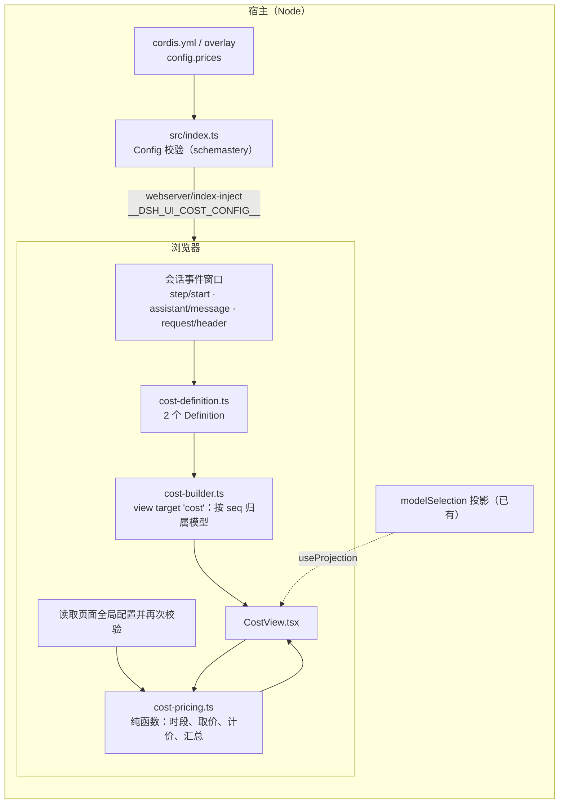

# 会话花费估算插件 技术方案

> Feature：999 | 有效需求来源：[PRD](../spec/PRD.md)（draft，2026-11-11，AC-01～AC-15） | Profile：standard | 模板：`mai-specs/_templates/TECH_DESIGN.tmpl.md` | 代码基线：`homework-1-build-plugin` @ `f261785c7b` | 状态：草案（[方案评审](../review/design_review.md)结论为有条件通过；P1 已按评审修改，待编排者核对）

[返回需求简报](../BRIEF.md) · [代码设计附录](CODE_DESIGN.md)

## 需求依据与验收

需求与 AC 以 [PRD](../spec/PRD.md) 为唯一维护源，本文只引用编号：FR-01～FR-08、BR-01～BR-07、NFR-01～NFR-03、AC-01～AC-15、文案 C-01～C-11、内置价目表（R-01）。

本方案对 PRD 的待确认事项和需回改处的处理：

| 编号 | 结论 | 依据 | 对 PRD 的影响 |
|---|---|---|---|
| Q-04（阻塞项） | **可行，有限制**。步骤开始时间取 `step/start` 事件的 `time`。模型 ID 不在 `assistant/message` 上，只在模型或请求头**变化时**记入 `request/header`（`header.config.model`），同一步内先于 `assistant/message` 写入。浏览器端取"该步 `assistant/message` 之前最近一条 `request/header`"的模型。窗口内没有任何 `request/header` 时，用宿主投影 `modelSelection.lastUsed`。窗口内有 header，但某步在第一条 header 之前时，推不出模型 | `packages/core/session/src/types.ts`（`SessionEventMap`）、`packages/core/agent-loop/src/agent.ts` `buildRequest()`、`packages/core/agent/src/model-selection.ts` | 推不出模型的步骤**计入未定价**（2026-11-11 用户决定 D-04），沿用 C-07、C-11，不新增文案 |
| Q-02 | DeepSeek 适配器把 `cache_creation_input_tokens` 映射为 `cacheWriteTokens`（`packages/llm/llm-deepseek/src/translate.ts`），DeepSeek 实际是否返回非 0 值，静态代码无法确认。BR-01 已按未命中单价覆盖该情况，不阻塞 | 同左 | 无；实现时用一次真实对话观察写入 token（任务 T9） |
| Q-03 | 仓库测试 `scripts/locale-dictionary-parity.spec.ts` 要求对象形式词典注册全部 8 种已发布语言（`scripts/shipped-locales.ts`）。因此提供 zh、en、ja、de、es、fr、pt、ru 共 8 种 | 同左 | NFR-01 写的是"至少中英文"，8 种语言满足该要求，不需回改 |
| PRD UI-01"错误"状态 | **改为加载时报错**（2026-11-11 用户决定 D-05）。单价配置由 schemastery 校验，负数或非数字会让插件加载失败，并报出字段路径。这符合 AGENTS.md "Misconfiguration fails loud at load" | AGENTS.md Conventions | **已同步**（2026-11-11，PRD commit `195a9e7bed`）：PRD UI-01"错误"状态已改为"单价配置无效时插件加载失败并报出出错字段"，并新增 AC-15 |
| Q-01 | 按 BR-03 实现，不影响设计结构 | — | 仍待负责人确认，不阻塞 |
| BR-07 在 ¥1 附近的格式 | 0.99995 ≤ 金额 < 1 时，按 4 位四舍五入会得到 1.0000，因此改按 2 位显示为 `¥1.00`（[CODE_DESIGN §5](CODE_DESIGN.md#5-视图要点costviewtsx)） | 评审 P2-2；负责人于 2026-11-11 接受 | **已回写（PRD BR-07、AC-12）** |

## 1. 方案概述

### 1.1 设计目标和设计原则

- **用户路径**：启用插件，打开会话，切换到"花费"页签，查看合计卡与每轮明细（BF-01）。加载更早轮次后合计更新（FR-07）；新步骤完成后金额实时更新（FR-08）。
- **成功标准**：AC-01～AC-15。计价、时段、格式、合并模型等规则用纯函数单元测试覆盖（AC-02～AC-08、AC-11、AC-12）；配置校验用负例单元测试覆盖（AC-15）；页签可见、分页、实时更新、README，以及错误配置下的启动报错按人工步骤验收（AC-01、AC-09、AC-10、AC-14、AC-15）。
- **不做**：沿用 PRD 第 7 章"不包含"。另外，本方案**不计**压缩摘要调用和失败重试尝试消耗的 token（PRD 只定义了"步骤"花费），见风险 R3。
- **硬约束**：
  - 浏览器端只读取会话事件，不访问网络（NFR-02）。
  - 文案全部走语言包（NFR-01）。
  - 新增的 `cordis.yml` 配置字段经过校验，配置错误时加载即失败（AGENTS.md）。
  - 实验包只通过 `--patch` overlay 挂载，不进入已发布 profile。这与 `client-ui-stats` 相同（`apps/web/tests/client-ui-stats-panel.overlay.yml` 的注释说明了 default-product isolation）。
  - 新包 `src` 需达到逐文件 100% 覆盖率（`test:coverage`）。
- **复用**：
  - `client-ui-stats` 的页签注册、Conversation Definition 与 view target 模式。分页不照搬 stats，直接调用会话的 `loadOlder()`（D-08）。
  - `ui-sidebar-documentpreview` 的"宿主入口通过 `webserver/index-inject` 把校验后的配置写进页面"模式。
  - 宿主投影 `modelSelection`。

### 1.2 整体架构

新增一个实验包 `packages/experimental/client-ui-cost`（`@deepseek-ai/dsh-experimental-client-ui-cost`）。不修改现有包的源码，只在仓库注册表中登记。

| 部分 | 新增/复用 | 说明 |
|---|---|---|
| 宿主入口 `src/index.ts` + `src/config.ts` | 新增 | 只校验配置并写入页面全局变量。不注册服务、工具或 RPC，保持 NFR-02 的"不新增宿主服务" |
| Definitions + view builder | 新增，模式复用 stats | 把事件折叠成"计价步骤"和"路由变更"两类节点，在 builder 中按 seq 为每步确定模型 |
| 计价与格式 | 新增，纯函数 | BR-01～BR-07 的唯一实现位置 |
| 视图 | 新增，交互复用 stats | 合计卡、部分加载提示、明细表、空状态与全部未定价状态 |
| 分页、投影 | 复用 | `session.loadOlder()`；会话快照的 `loadingOlder`、`hasMore`；`useProjection('modelSelection')` |

### 1.3 关键决策与 Review 索引

| 决策 | 推荐及理由 | 代价与备选 | 待判断事项/确认状态 | 详情 |
|---|---|---|---|---|
| D-01 新建独立实验包，不扩展 `client-ui-stats` | 需求是一个独立页签，自成一个功能单元；stats 已有 6000+ 行，混入会增加它的维护面 | 每轮的 token 格式化函数要小量重复实现，需过 `pnpm run duplication`。备选：在 stats 中加一列，但 PRD 明确要求单独页签（FR-01） | 已按 PRD 定 | §2.3.1 |
| D-02 模型归属在浏览器端按 `request/header` 推导 | 不改核心事件，也不新增投影，零宿主改动 | 窗口最前段可能推不出模型（D-04）。备选：新增宿主投影，或在 `assistant/message` 上加 `model` 字段，但这会改 `SessionEventMap` 并牵动两套 SDK 快照，成本远超当前需求 | 已核实代码 | [CODE_DESIGN §2](CODE_DESIGN.md#2-模型归属cost-builderts) |
| D-03 配置经宿主入口注入页面 | 仓库中已有且有文档说明的模式（documentpreview README："Settings are embedded in each served page"）。配置在宿主加载时校验 | 修改配置后需重启并刷新页面。备选：用户设置页编辑，需要新增设置存储和 UI，超出范围 | 已定 | [CODE_DESIGN §4](CODE_DESIGN.md#4-配置与宿主入口configts--indexts) |
| D-04 推不出模型的步骤计入未定价 | 不新增状态和文案；加载更早轮次后自动消失 | "未定价"在这种情况下的含义略宽，README 中说明 | **用户已确认（2026-11-11）** | §2.1.2 |
| D-05 无效单价加载时报错 | 遵循仓库硬规则 | 与 PRD UI-01"错误"状态不同 | **用户已确认（2026-11-11）**；PRD 已同步（UI-01、AC-15） | 需求依据表 |
| D-06 配置按模型**整条**提供（两个时段 × 三个单价），整条替换内置价 | 语义简单：一个模型只有一个价格来源，无需字段级合并 | AC-07 中用户要写全 `deepseek-flash` 的 6 个数。备选：字段级合并，需定义合并与缺省规则，测试面翻倍 | **已接受**（2026-11-11，评审 P2-1） | [CODE_DESIGN §4](CODE_DESIGN.md#4-配置与宿主入口configts--indexts) |
| D-08 "加载更早"直接调用 `session.loadOlder()`，状态读取会话快照的 `loadingOlder` 与 `hasMore` | 本页签只有一个按钮，不需要 stats 为滚动到顶自动加载、保持滚动位置所做的 `grew` / `retry` / `exhausted` 判断；`loadOlder()` 的契约保证请求进行中时返回同一个完成结果（`packages/api/session-controller/src/client/contract/session.ts` 中 `loadOlder` 的 JSDoc）。照搬 stats 的 `whenOpened` 和 `loadOlder`（`client-ui-stats/src/client/index.ts:33-52`、`:95-120`）会触发 `pnpm run duplication`（`.jscpd.json`：60 token / 6 行，`exitCode: 1`） | 无。会话尚未打开时点击，由会话本身处理（`loadOlder` 在未打开时为空操作，按钮因 `hasMore` 为 false 也不显示） | **已修改**（评审 P1-1） | §2.1.2 第 4 点；[CODE_DESIGN §5](CODE_DESIGN.md#5-视图要点costviewtsx) |
| D-09 页面拿不到全局配置时，浏览器端 `apply` 直接抛错 | 挂载本包时总会同时加载宿主入口；宿主入口成功加载时总会注入配置（`prices` 缺省为 `{}`）。拿不到配置只可能是宿主入口未运行或配置无效，回退到内置价会静默绕过 AC-15。`packages/client/modules/src/index.ts:1046` 只排除没有 fiber 或已禁用的条目，宿主失败后浏览器端代码是否仍会下发，尚待 T8 实测 | 无 | **已修改**（评审 P1-2） | §2.1.2 失败路径；[CODE_DESIGN §4](CODE_DESIGN.md#4-配置与宿主入口configts--indexts) |
| D-07 计价在视图层用 `useMemo` 计算，builder 只做事件归并 | builder 拿不到投影（`modelSelection`），视图拿得到；计价保持纯函数 | 每次快照变化重新计价，成本为 O(步数)，可接受 | — | [CODE_DESIGN §3](CODE_DESIGN.md#3-计价与汇总cost-pricingts) |

## 2. 详细设计方案

### 2.1 核心结构设计

#### 2.1.1 数据结构设计

不新增持久化数据，不新增会话事件。浏览器端的内存结构（完整类型见 [CODE_DESIGN §1](CODE_DESIGN.md#1-类型cost-contractts)）：

- `CostStepNode`：一步的 `turn`、`step`、开始时间、`assistant/message` 的 seq，以及四类 token。没有 `usage` 的步骤不产生节点，即 BR-06。
- `CostRouteNode`：一条 `request/header` 的 seq 与 `model`。
- `CostSnapshot`（builder 输出）：`steps`（已带推导出的 `model: string | null`）、`windowHasHeader`。
- `PriceTable`：`Record<modelId, { peak: UnitPrices; offPeak: UnitPrices }>`，`UnitPrices = { cacheHit, cacheMiss, output }`，单位为元 / 百万 token。
- `CostSummary`（计价输出）：合计金额、缓存节省、模型列表、未定价步数、每轮行。

#### 2.1.2 数据流设计

1. **折叠**：
   - `cost-step` Definition 以 `step/start` 为起点，用 `assistant/message` 更新。起点不在窗口内时，由 `assistant/message` 建立状态，此时开始时间回退为该消息的 `time`，与真实开始时间相差一个模型调用时长，只影响跨越时段边界的那一步。
   - `cost-route` Definition 为每条 `request/header` 生成一个节点。
2. **模型归属**（builder）：把 route 节点按 seq 排序。每步取 `seq < step.messageSeq` 的最近一条 route 的模型。找不到时为 `null`，并输出 `windowHasHeader`。
3. **计价**（视图 `useMemo`）：
   - `model === null` 且 `!windowHasHeader` 时，用 `modelSelection.lastUsed?.model`：窗口内没有任何 header，说明窗口期间模型未变。
   - 其余 `null` 记为未定价（D-04）。
   - 取价：配置优先于内置（BR-04）。按北京时间判断时段（BR-02），按 BR-01、BR-03 计算，再汇总为每轮和合计。
4. **部分加载**：`session.getSnapshot().hasMore === true` 时显示区域 C（C-08 中的 count 取已加载步骤涉及的轮次数）。"加载更早"按钮直接调用 `session.loadOlder()`：`loadingOlder` 为 true 时显示加载中并禁用按钮；调用失败时显示可重试的失败提示；加载完成后 `hasMore` 变为 false，提示条消失（D-08）。
5. **实时更新**：`assistant/message` 的 publication 设为 `immediate`，新步骤进入窗口后 builder 增量 `apply`，视图重新计价（FR-08）。

失败路径：

- 配置无效时宿主加载失败，并报出出错字段（D-05、AC-15）。
- 页面拿不到全局配置时，浏览器端 `apply` 直接抛错，错误信息写明宿主入口未运行或配置无效；不回退到内置价，页签不注册（D-09）。
- 浏览器端仍用同一 schema 解析全局配置，因为这是跨进程边界的输入（AGENTS.md："validate at … process, and wire boundaries"）。

#### 2.1.3 接口设计

- **`cordis.yml`**：插件条目的 `config.prices`，见 §2.2。
- **页签槽位**：`conversation.view`，`id: 'cost'`，`order: 45`（排在 stats 的 40 之后），`label: t('view.cost')`。
- **对外导出**：client 入口导出 `Config` 类型与 `CostSnapshot` 类型，供测试使用。不导出服务，也不声明 `SessionEventMap` 或 `SessionProjectionMap` 合并。

### 2.2 配置变更

| 配置项 | 当前用途与来源 | 默认值/缺失行为 | 生效时机 |
|---|---|---|---|
| `prices`（`Record<string, { peak, offPeak }>`，每个时段 `{ cacheHit, cacheMiss, output }`，均为 ≥ 0 的有限数） | FR-06：覆盖或新增模型单价；键为步骤记录的模型 ID | 缺省为 `{}`，只用内置价目表。任一字段缺失、负数或非数字时插件加载失败（D-05） | 宿主启动时校验；页面加载时读取。修改后需重启 DSH 并刷新页面 |

内置价目表是 PRD R-01 的业务数据，作为常量 `BUILTIN_PRICES` 放在 `cost-pricing.ts`。它不是部署可调参数，部署方的调整通过 `prices` 覆盖完成，所以不违反"No hardcoded tunables"。

### 2.3 分模块详细设计

#### 2.3.1 包结构（全部为新增文件）

| 文件 | 职责 |
|---|---|
| `package.json` | 参照 stats：`dsh.client.inject` 列出 `dsh-api-session-controller`、`dsh-client-locale`、`dsh-client-ui-conversation`、`dsh-client-ui-renderer`，`platform: web`；`exports` 包含 `.`、`./client`、`./locale/*.json` |
| `tsconfig.json`、`tsdown.config.ts` | 复制 stats，并按实际依赖精简 references；host 入口多引用 `host/webserver`（仅类型） |
| `src/index.ts`、`src/config.ts` | 宿主入口：`Config` schema，以及 `webserver/index-inject` 注入 |
| `src/client/index.ts` | 读取并校验全局配置（缺失时抛错，D-09）；注册语言包、Definitions、view target 和页签；向视图注入会话快照和 `loadOlder: () => session.loadOlder()`（D-08） |
| `src/client/cost-contract.ts` | 类型 |
| `src/client/cost-definition.ts` | `cost-step`、`cost-route` 两个 Definition |
| `src/client/cost-builder.ts` | view target `cost` 的 builder：节点集合与模型归属 |
| `src/client/cost-pricing.ts` | `BUILTIN_PRICES`、`pricePeriod`、`resolvePrices`、`priceSummary` |
| `src/client/cost-format.ts` | `formatYuan`（BR-07）、`formatTokens`（k / M，与 stats 显示一致） |
| `src/client/CostView.tsx`、`cost.module.css` | 合计卡、提示条、明细表（`<table>` 带 `<th scope="col">`，满足 NFR-03） |
| `src/client/locales.ts`、`locale/*.json` | 8 种语言的界面文案与包元数据（title、description） |
| `README.md`、`README.zh.md`、`README.i18n.yaml` | 安装、配置、启动、验证（AC-14），并说明 D-04 的"未定价"含义与已知低估（R3） |
| `tests/*.client.spec.ts(x)` | 见任务 T7 |

仓库登记（修改）：

- `tsconfig.base.json` 的 `paths`、`tsconfig.client.json` 的 references。
- `packages/experimental/README.md` 的包列表。
- `apps/web/tests/client-ui-cost.overlay.yml`（新增，供启动验证用）。
- 生成目录：`docs/config-catalog.md` 与 `.zh.md`（运行 `pnpm run gen-config-catalog`），以及 client catalog（如 `gen-client-catalog` 覆盖实验包则一并生成）。

#### 2.3.2 视图状态

视图状态对应 PRD UI-01：

| 条件 | 显示 |
|---|---|
| `steps` 为空 | C-09 空状态 |
| 有步骤但全部未定价 | 合计卡显示 C-10，不显示金额；明细照常显示，花费列为 C-11 |
| 默认 | 合计卡：C-02 金额、C-03 金额、C-04 模型列表、C-06；未定价步数 ≥ 1 时追加 C-07 |
| `hasMore` | 区域 C：C-08 与"加载更早"按钮；`loadingOlder` 时显示加载中，失败时显示可重试提示（文案在本包语言包中定义，D-08） |
| 某轮部分步骤未定价 | 金额后加标记（`*`，`title` / `aria-label` 使用 C-07 文案） |

## 3. 风险评估

| 风险与触发条件 | 影响 | 缓解措施 | 验证方式 |
|---|---|---|---|
| R1 窗口内有模型切换，且切换前的步骤在窗口最前面 | 这些步骤计为未定价，合计偏低 | D-04：计入 C-07 的计数，提示用户；加载更早后恢复。评审 P2-3 提出：窗口内第一条请求头的 `reason` 为 `series` 时可沿用同一模型，**已决定延后**；触发条件为用户反馈未定价步骤过多 | builder 单元测试；人工：切换模型后打开历史会话 |
| R2 起点 `step/start` 不在窗口内 | 开始时间回退为消息时间，跨越时段边界的那一步可能用错价 | 只影响窗口第一步；README 说明 | 单元测试覆盖回退分支 |
| R3 压缩摘要调用、失败重试尝试也消耗 token，但不是"步骤" | 估算偏低 | PRD 范围外；README 说明。如需计入，应回到 PRD 扩展 FR | — |
| R4 官方调价 | 内置价过期 | `prices` 配置覆盖（FR-06）；R-01 要求实现前再次核对价格 | 实现前人工核对价目页 |
| R5 多个 Definition 匹配同一事件（stats、trajectory 也匹配 `request/header`） | 无，已有先例 | — | 插件测试同时挂载 stats |
| R6 假设"会话窗口是日志的连续后缀"（D-02 回退逻辑依赖它） | 假设不成立时，`lastUsed` 回退可能用错模型 | 实现时核对 `ui-conversation` 的 `replaceWindow` / `prepend` 语义；不成立时去掉回退，统一按 D-04 处理 | 代码核对 + builder 测试 |

## 4. 兼容性考量

纯新增的实验包，不改动现有包、事件、投影或 SDK 输出。不涉及 breaking change，不需要升级指南，不影响 Session 格式版本或 `SCHEMA_VERSION`。

## 5. 任务分解

| 任务 | 关联模块/决策 | 变更文件（新增/修改/删除） | 前置依赖 | 交付物与验收条件 |
|---|---|---|---|---|
| T1 包骨架与登记 | §2.3.1 | 新增 `package.json`、`tsconfig.json`、`tsdown.config.ts`、`src/index.ts`（暂为空实现）、`src/client/index.ts`；修改 `tsconfig.base.json`、`tsconfig.client.json`、`packages/experimental/README.md` | — | `pnpm install`、`pnpm run typecheck`、`pnpm run hygiene` 通过 |
| T2 计价与格式纯函数 | D-06、BR-01～BR-07 | 新增 `cost-contract.ts`、`cost-pricing.ts`、`cost-format.ts` | T1 | 单元测试覆盖 AC-02、AC-03（含边界 08:59:59、11:59:59、12:00:00、周六，以及非 UTC+8 的运行时区）、AC-04、AC-05、AC-06、AC-07、AC-12 |
| T3 Definitions 与 builder | D-02、D-04 | 新增 `cost-definition.ts`、`cost-builder.ts` | T2 | 单元测试：模型归属（无 header、header 在中间、header 在开头）、无 usage 步骤（AC-11）、起点缺失回退（R2）、多轮排序（AC-08） |
| T4 配置注入 | D-03、D-05、AC-15 | 新增 `src/config.ts`；完善 `src/index.ts`；新增 `apps/web/tests/client-ui-cost.overlay.yml` | T2 | 单元测试覆盖 AC-15 的自动部分：负数、非数字（含 `NaN`、`Infinity` 和字符串）、缺少某个单价字段时，`Config()` 抛错，且错误信息包含出错的字段路径（如 `prices.deepseek-flash.peak.output`）；合法配置原样通过；页面全局配置缺失时，浏览器端 `apply` 抛错且不注册页签（D-09） |
| T5 视图与语言包 | UI-01、NFR-01、NFR-03 | 新增 `CostView.tsx`、`cost.module.css`、`locales.ts`、`locale/*.json`（8 种语言） | T3 | 视图测试覆盖空状态、全部未定价、部分未定价标记，以及 `hasMore` 提示与 `loadingOlder` 加载中、失败重试；`verify-client-ui-i18n`、locale parity 测试通过（AC-13） |
| T6 文档与生成产物 | AC-14 | 新增 README 三件套；重新生成 `docs/config-catalog*.md` | T4、T5 | `pnpm run doc-sync` 或 `pnpm run test:docs` 通过 |
| T7 覆盖率与构建 | 仓库门槛 | `tests/*.client.spec.ts(x)` | T2～T5 | 新包 `src` 逐文件 100% 覆盖率；`pnpm run build:artifacts` 后 `build:check` 通过；`pnpm run duplication` 通过 |
| T8 人工验收 | AC-01、AC-05、AC-09、AC-10、AC-14、AC-15 | — | T7 | 按 README 用 `pnpm dsh web --patch apps/web/tests/client-ui-cost.overlay.yml`（附加 `pin-browse-picker` overlay）启动，做一次真实对话并逐条记录观察结果。AC-15：在 overlay 中写入一个负数单价后启动，同时记录宿主日志中的报错和浏览器中页签是否出现（D-09 要求页签不出现）；改回合法值并重启后，页签恢复 |
| T9 核实 Q-02 | BR-01 | — | T8 | 记录一次真实 DeepSeek 调用的 `cacheWriteTokens` 值，回写 PRD Q-02 |

**测试计划缺口**（回传编排者）：项目中暂无 TEST_PLAN。AC-01、AC-09、AC-10、AC-14 只有人工步骤；可参照 `apps/web/tests/client-ui-stats-panel.e2e.ts` 增加一个 Web e2e，至少覆盖 AC-01、AC-09。是否增加由 `my-create-test-plan` 决定。另外，仓库要求"user-visible change 更新 keyless recorded-session snapshot"，而实验包不进入已发布 profile，是否适用需在 pre-push 阶段按 `snapshots/AGENTS.md` 确认。
