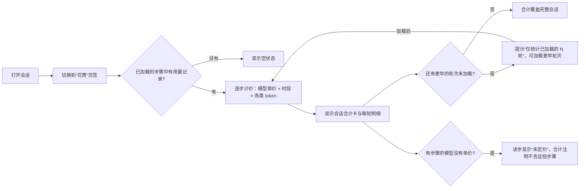

# PRD：会话花费估算插件

> 状态：draft | 负责人：Runhua Xue | Profile：standard | 模板：`mai-specs/_templates/PRD.tmpl.md`

[返回需求简报](../BRIEF.md)

## 1. 背景与目标（Why）

- **背景/痛点**：DSH 现在只显示 token 用量，看不到花了多少钱。已有的上下文用量条（ContextMeter）、每轮用量面板（TurnUsagePanel）和实验插件 `client-ui-stats` 都只展示 token 数、缓存命中率和耗时，仓库里没有任何按价格换算花费的能力（见[素材索引](../context/_INDEX.md)）。DeepSeek 官方按模型、缓存是否命中、输入或输出、高峰或空闲时段分别计价，用户很难靠 token 数心算出实际花费。
- **目标**：用户在 DSH 会话里打开一个页签，就能看到本会话和每一轮大约花了多少钱（人民币），以及缓存帮忙省了多少钱。
- **成功指标**：对同一批步骤，插件算出的金额与按官方价目表手算的结果一致（误差只来自显示时的四舍五入）。

## 2. 用户与场景（Who / When）

| 用户故事 ID | 目标用户 | 触发场景 | 用户故事：作为…我希望…以便… | 关联需求 |
|---|---|---|---|---|
| US-01 | 使用 DeepSeek API key 的 DSH 用户 | 一次较长的对话或编码任务结束后 | 作为用户，我希望看到这次会话一共花了多少钱、缓存省了多少钱，以便判断使用成本 | FR-01、FR-02、FR-04 |
| US-02 | 同上 | 发现花费偏高时 | 作为用户，我希望看到每一轮各花了多少钱，以便找出最贵的那几轮 | FR-03 |
| US-03 | 使用自定义价格或非 DeepSeek 官方模型的用户 | 官方调价，或接入了其他模型 | 作为用户，我希望能自己配置单价，以便估算结果仍然可信 | FR-06 |
| US-04 | 打开历史长会话的用户 | 恢复或查看一个很长的旧会话 | 作为用户，我希望知道当前合计是否包含了全部轮次，以便不被不完整的数字误导 | FR-07 |

## 3. 总体业务流程

### BF-01：查看会话花费

**参与者与起止**：DSH Web UI 用户。从会话界面切换到"花费"页签开始，到看完合计与明细、或切换回其他页签结束。



**流程说明**：每一步按该步使用的模型和发生时间所在的时段取单价（BR-01、BR-02、BR-04），逐步累加为每轮花费和会话合计（FR-03、FR-02）。会话进行中，新完成的步骤会实时计入（FR-08）。

## 4. 功能需求（What）

### 4.1 新增需求

| 需求编号 | 触发条件 | 输入 | 预期行为 | 输出/结果 | 关联需求编号 |
|---|---|---|---|---|---|
| FR-01 | 插件已启用，用户打开任一会话 | 无 | 在会话视图的页签栏中新增“花费”页签，位置与“统计”等页签并列 | 用户能切换到“花费”页签（UI-01） | US-01 |
| FR-02 | 用户位于“花费”页签，且已加载的步骤中至少有一步带用量记录 | 已加载步骤的用量与模型 | 计算并展示会话合计：估算总花费、缓存节省金额、涉及的模型、已计价步数；有未定价步骤时注明（BR-05） | 合计卡（UI-01 区域 A） | US-01、BR-01～BR-07 |
| FR-03 | 同 FR-02 | 同 FR-02 | 按轮次列出明细，每轮一行：轮次序号、输入 token（缓存未命中、命中、写入之和）、输出 token、估算花费。只有至少含一步用量记录的轮次才占一行；整轮都没有用量记录的轮次（如整轮被取消）不显示 | 每轮明细表（UI-01 区域 B），按轮次从早到晚排列 | US-02、BR-01、BR-06 |
| FR-04 | 计算任一步的花费时 | 该步的模型、发生时间、四类 token 数 | 按该步模型的单价、该步所在时段（高峰或空闲）计价；同一会话里不同步骤用了不同模型时各自计价 | 每步花费，汇总进 FR-02、FR-03 | BR-01、BR-02、BR-04 |
| FR-05 | 插件启用，未做任何价格配置 | 无 | 使用内置的 DeepSeek 官方价目表（R-01）为 `deepseek-flash`、`deepseek-v4-pro` 计价 | 开箱即可看到这两个模型的花费 | BR-04 |
| FR-06 | 用户在插件配置中为某个模型填写了单价 | 模型 ID 及其单价（缓存命中输入、缓存未命中输入、输出；高峰与空闲） | 该模型改用配置的单价，覆盖内置价格；内置表中没有的模型也可以通过配置获得单价 | 金额按配置单价重新计算 | US-03、BR-04 |
| FR-07 | 会话还有更早的轮次没有加载 | 当前已加载的轮次数 | 合计和明细只包含已加载的轮次，并显示提示（文案 C-08）；用户可以加载更早的轮次，加载后合计随之更新。“花费”页签与“对话”等页签共用同一会话窗口，在本页签加载更早轮次后，其他页签也会显示这些更早的内容 | 提示条与“加载更早”操作 | US-04 |
| FR-08 | 用户停留在“花费”页签时，会话中有新的步骤完成 | 新步骤的用量 | 新步骤自动计入对应的轮次和合计，无需刷新 | 金额实时更新 | US-01 |

### 4.2 变更需求

无。本插件只新增页签，不改变 DSH 现有页面和行为。

## 5. UI 视觉与交互

### UI-01：“花费”页签

**设计依据**：拟议线框（下图），以及用户在 2026-11-11 会话中选定的预览方案；布局和组件风格沿用同一槽位中的“统计”页签（`packages/experimental/client-ui-stats`）。线框中的数字只用于示意。

```
┌ 花费 ─────────────────────────────────────────┐
│ 区域 A：会话合计                               │
│   估算花费 ¥0.8412      缓存节省 ¥1.9200       │
│   模型 deepseek-flash、deepseek-v4-pro         │
│   ⓘ 按 DeepSeek 官方价目估算，可能与实际账单不同 │
├───────────────────────────────────────────────┤
│ ⓘ 仅统计已加载的 12 轮。 [加载更早]   ← 区域 C │
├──────┬───────────┬──────────┬────────────────┤
│ 轮次 │ 输入      │ 输出     │ 花费           │ ← 区域 B
│ #1   │ 12.3K     │ 0.8K     │ ¥0.0472        │
│ #2   │ 45.1K     │ 2.1K     │ ¥0.2100        │
│ #3   │ 8.0K      │ 0.4K     │ 未定价         │
└──────┴───────────┴──────────┴────────────────┘
```

| 页面区域/控件 | 新增/变更 | 对照设计的功能与交互说明 | 关联需求 |
|---|---|---|---|
| 页签“花费” | 新增 | 位于会话视图页签栏，与“对话”“轨迹”“统计”等并列 | FR-01 |
| 区域 A：会话合计卡 | 新增 | 显示估算花费、缓存节省、涉及模型和“估算”说明；有未定价步骤时追加文案 C-07 | FR-02、BR-05、BR-07 |
| 区域 B：每轮明细表 | 新增 | 每轮一行，列为轮次、输入、输出、花费；整轮都未定价时花费列显示“未定价”，部分步骤未定价时显示已计价部分的金额并加标记 | FR-03、BR-05、BR-06 |
| 区域 C：部分加载提示 | 新增 | 只在还有更早轮次没加载时出现；“加载更早”沿用统计页签的分页行为和文案 | FR-07 |

**状态与反馈**：

- **默认**：有可计价步骤时，显示区域 A、B，必要时显示区域 C。
- **空状态**：已加载步骤中没有任何用量记录时，显示文案 C-09，不显示合计卡和明细表。会话还有更早的轮次没有加载时，在 C-09 下方仍显示“加载更早 / Load earlier”按钮，不显示 C-08。
- **加载中**：加载更早轮次时显示 C-12，按钮不可再次点击。
- **加载失败**：加载更早轮次失败时显示 C-13，点击后重试。
- **全部未定价**：所有步骤都没有单价时，合计卡显示文案 C-10，不显示金额，仍显示模型列表（C-04）。
- **错误**：插件配置中的单价无效时（如负数、非数字或缺少字段；单价为 0 合法），只有本插件加载失败，DSH 其他功能照常；错误写入终端日志，并带出错配置项的字段路径（如 `prices.deepseek-flash.peak.output`）；Web 页面上不另外提示（浏览器开发者工具控制台中出现报错可以接受），页签不出现，也不按“未定价”降级。这遵循仓库规则 “Misconfiguration fails loud at load”（`AGENTS.md`）。决定见[技术方案](../design/TECH_DESIGN.md) D-05（AC-15）。
- **权限、禁用**：不适用，页签只读，没有需要权限的操作。

## 6. 业务规则与约束（Rules）

| 规则 ID | 业务规则、状态流转、权限或数据约束 | 关联需求 |
|---|---|---|
| BR-01 | 单步花费 =（缓存未命中输入 token × 未命中单价 + 缓存命中输入 token × 命中单价 + 缓存写入 token × 写入单价 + 输出 token × 输出单价）÷ 1,000,000。单价单位为“元 / 百万 token”。官方价目没有单列缓存写入价，写入单价默认按缓存未命中单价计算（见待确认事项 Q-02）。注：目前 DeepSeek 返回的写入量为 0 | FR-04 |
| BR-02 | 时段按该步开始时间、换算为北京时间（UTC+8）判断：周一至周五的 [09:00, 12:00) 和 [14:00, 18:00) 为高峰，其余时间（含周末）为空闲。插件不识别法定节假日和调休，节假日落在工作日时仍按高峰计价，这是已接受的估算误差 | FR-04 |
| BR-03 | 缓存节省 = Σ 每步缓存命中输入 token ×（该步未命中单价 − 该步命中单价）÷ 1,000,000，即“如果这些 token 没命中缓存会多花的钱” | FR-02 |
| BR-04 | 单价优先级：插件配置中该模型的单价 > 内置官方价目表。按步骤记录的模型 ID 匹配。内置价目表仅包含 `deepseek-flash`、`deepseek-v4-pro`，数值以 R-01 为准 | FR-04、FR-05、FR-06 |
| BR-05 | 某步的模型在配置和内置表中都没有单价，或在已加载的记录中无法确定该步使用的模型时（技术方案 D-04，2026-11-11 确认），该步记为“未定价”：不计入任何金额，合计卡注明“不含 N 步未定价”（C-07） | FR-02、FR-03 |
| BR-06 | 没有用量记录的步骤（如被取消、失败、仍在进行中）不计价，也不计入未定价步数 | FR-03 |
| BR-07 | 金额一律以人民币显示，前缀 `¥`。≥ ¥1 时保留 2 位小数；< ¥1 时保留 4 位小数；按 4 位小数四舍五入后达到 ¥1 的金额（0.99995 ≤ 金额 < 1，如 ¥0.99995）按 ≥ ¥1 的规则显示为 `¥1.00`；大于 0 但四舍五入后为 0 时显示 `<¥0.0001`。合计卡始终带“估算”说明（C-06） | FR-02、FR-03 |

| 非功能 ID | 性能、可靠性、安全或可访问性要求 | 适用条件与验证口径 |
|---|---|---|
| NFR-01 | 界面文字全部走语言包，不硬编码，符合仓库规则“Client UI copy is locale-owned”（`AGENTS.md`）；至少提供中文和英文，英文使用句首大写（sentence case） | 仓库的 `verify-client-ui-i18n` 检查通过；切换界面语言后文案随之变化 |
| NFR-02 | 只运行在浏览器端，只读取会话中已有的数据；不新增宿主服务，不为获取价格访问网络 | 代码审查；断网时页签仍能按内置或配置价格计价 |
| NFR-03 | 表格中的数字列可以被屏幕阅读器读出，列头有可访问名称 | 人工检查表格语义 |

## 7. 范围与边界（Scope）

- **包含**：FR-01～FR-08；内置 DeepSeek 官方价目表；插件配置覆盖单价；中文、英文文案；满足作业要求的插件 README（安装、配置、启动、验证命令）。
- **不包含**：
  - 每一步的明细展开（已有 `client-ui-stats` 提供步骤级统计）。
  - 跨会话、按天或按月的累计花费。
  - 预算上限、超支提醒。
  - 与 DeepSeek 实际账单对账，或调用官方余额接口。
  - 法定节假日日历。
  - 美元等其他币种。
  - 子 agent 在其他会话中产生的花费。
- **依赖**：
  - DSH 会话事件中每一步的 token 用量（未命中输入、命中输入、缓存写入、输出）与发生时间。
  - 每一步使用的模型 ID 在浏览器端可以取到。这一点待技术设计核实（Q-04）。
  - 会话视图页签槽位与历史分页能力（参考 `client-ui-stats`）。

## 8. 研发资源

| 资源 ID | 类型 | 实际链接/路径或本文位置 | 用途/关联需求 | 确认与核验状态 |
|---|---|---|---|---|
| R-01 | 官方价目 | https://api-docs.deepseek.com/zh-cn/quick_start/pricing ；数值见下方“内置价目表” | FR-05、BR-02、BR-04 | 2026-11-11 读取；页面未标注更新日期，实现前需再次核对 |
| R-02 | 参考实现 | `packages/experimental/client-ui-stats` | UI-01 布局、页签注册、历史分页 | 已阅读 README 与入口代码 |
| R-03 | 模型目录 | `packages/llm/llm-deepseek/src/models.ts` | 内置模型 ID：`deepseek-flash`、`deepseek-v4-pro` | 已核验 |

### 最终文案

| 文案 ID | 位置/触发状态 | 最终文字（中文 / 英文） | 变量与格式规则 |
|---|---|---|---|
| C-01 | 页签标题 | 花费 / Cost | — |
| C-02 | 合计卡：总花费标签 | 估算花费 / Estimated cost | 金额按 BR-07 |
| C-03 | 合计卡：缓存节省标签 | 缓存节省 / Cache savings | 金额按 BR-07 |
| C-04 | 合计卡：模型标签 | 模型 / Models | 多个模型用顿号（英文用逗号）分隔；包含已知模型 ID 但未定价的模型 |
| C-05 | 明细表列头 | 轮次、输入、输出、花费 / Turn, Input, Output, Cost | token 数沿用统计页签的大写 `K` / `M` 缩写格式（如 `5.2K`） |
| C-06 | 合计卡说明 | 按 DeepSeek 官方价目或你配置的单价估算，可能与实际账单不同 / Estimated from DeepSeek list prices or your configured prices; may differ from your bill | — |
| C-07 | 合计卡：有未定价步骤 | 不含 {count} 步未定价 / Excludes {count} unpriced steps | `count` ≥ 1 |
| C-08 | 区域 C：部分加载提示 | 仅统计已加载的 {count} 轮。 / Only the {count} loaded turns are counted. | `count` 为已加载步骤涉及、且至少含一步用量记录的轮次数，≥ 1；窗口开头只加载了部分步骤的轮次也计入，不额外提示；后接“加载更早 / Load earlier”按钮 |
| C-09 | 空状态 | 当前窗口里还没有可以计价的步骤。 / No priced step in the current window yet. | — |
| C-10 | 全部未定价 | 这些步骤使用的模型都没有单价，可以在插件配置中添加。 / None of these models has a price; add one in the plugin config. | — |
| C-11 | 单元格：未定价 | 未定价 / Unpriced | — |
| C-12 | 区域 C：加载更早进行中 | 正在加载更早的轮次… / Loading earlier turns… | 与统计页签同义；在本插件语言包中定义 |
| C-13 | 区域 C：加载更早失败 | 加载失败，重试 / Load failed, retry | 与统计页签同义；整段可点击重试 |

### 业务枚举与预置数据：内置价目表（元 / 百万 token，来源 R-01）

| 模型 ID | 时段 | 输入（缓存命中） | 输入（缓存未命中） | 输出 |
|---|---|---|---|---|
| `deepseek-flash` | 高峰 | 0.04 | 2 | 8 |
| `deepseek-flash` | 空闲 | 0.02 | 1 | 4 |
| `deepseek-v4-pro` | 高峰 | 0.30 | 9.0 | 27.0 |
| `deepseek-v4-pro` | 空闲 | 0.15 | 4.5 | 13.5 |

## 9. 验收标准（Acceptance Criteria）

### AC-01：页签可见

**关联**：FR-01

- **Given**：插件已按 README 启用，DSH Web UI 已启动
- **When**：用户打开任一会话
- **Then**：会话视图页签栏中出现“花费”页签，点击后进入 UI-01
- **验证方式**：人工步骤，在真实运行的 DSH 中观察

### AC-02：高峰时段按高峰价计价

**关联**：FR-04、BR-01、BR-02

- **Given**：一步使用 `deepseek-flash`，开始于北京时间周三 10:00，未命中输入 10,000、命中输入 90,000、写入 0、输出 1,000 token
- **When**：计算该步花费
- **Then**：花费为 ¥0.0316（10,000×2 + 90,000×0.04 + 1,000×8 = 31,600 元·token，÷ 1,000,000）
- **验证方式**：自动测试（计价函数单元测试）

### AC-03：空闲时段与周末按空闲价计价

**关联**：FR-04、BR-02

- **Given**：与 AC-02 相同的用量，分别开始于北京时间周三 12:00:00、周三 08:59:59、周六 10:00
- **When**：计算花费
- **Then**：三者均按空闲价计价，花费为 ¥0.0158；开始于周三 11:59:59 的步骤按高峰计价，花费为 ¥0.0316
- **验证方式**：自动测试（覆盖时段边界与时区换算）

### AC-04：缓存节省

**关联**：FR-02、BR-03

- **Given**：AC-02 中的那一步（高峰）
- **When**：计算缓存节省
- **Then**：缓存节省为 ¥0.1764（90,000 ×（2 − 0.04）÷ 1,000,000）
- **验证方式**：自动测试

### AC-05：一个会话用了多个模型

**关联**：FR-04、BR-04

- **Given**：同一会话中，一步用 `deepseek-flash`、另一步用 `deepseek-v4-pro`，用量相同、时段相同
- **When**：查看合计与明细
- **Then**：两步分别按各自模型的单价计价，合计等于两者之和，合计卡的“模型”中列出两个模型
- **验证方式**：自动测试 + 在真实 DSH 中切换模型对话一次后人工观察

### AC-06：未定价模型

**关联**：BR-05、FR-02、FR-03

- **Given**：会话中有一步使用的模型在配置和内置表中都没有单价，其余步骤有单价
- **When**：查看“花费”页签
- **Then**：按 UI-01 区域 B 的规则显示该步所在轮次的花费：
  - 该轮所有步骤都未定价时，花费列显示“未定价”（C-11）；
  - 该轮还有已计价的步骤时，显示已计价部分的金额，并加上部分未定价标记。

  合计只包含有单价的步骤，并显示“不含 1 步未定价”（C-07）。所有步骤都没有单价时显示 C-10，不显示金额，仍显示模型列表（C-04）。
- **验证方式**：自动测试

### AC-07：配置覆盖内置价格

**关联**：FR-06、BR-04

- **Given**：用户在插件配置中把 `deepseek-flash` 的高峰输出单价设为 16
- **When**：重新计算 AC-02 中那一步
- **Then**：花费为 ¥0.0396（输出部分从 ¥0.008 变为 ¥0.016）；配置中新增一个内置表没有的模型后，该模型的步骤也能计价
- **验证方式**：自动测试 + 人工修改配置后在真实 DSH 中观察

### AC-08：每轮明细与合计一致

**关联**：FR-02、FR-03

- **Given**：会话中有多轮已完成的对话
- **When**：查看“花费”页签
- **Then**：每轮一行，按轮次从早到晚排列；各轮花费之和等于合计卡的估算花费（显示时的四舍五入误差除外）
- **验证方式**：自动测试 + 人工核对

### AC-09：部分加载提示

**关联**：FR-07

- **Given**：打开一个较早轮次尚未加载的长会话
- **When**：查看“花费”页签
- **Then**：显示“仅统计已加载的 N 轮。”和“加载更早”按钮；点击加载后 N 增大，合计金额随之更新；全部加载后提示消失
- **验证方式**：人工步骤，在真实 DSH 中打开历史会话

### AC-10：实时更新

**关联**：FR-08

- **Given**：用户停留在“花费”页签
- **When**：在会话中发送一条消息，模型完成回复
- **Then**：不刷新页面，新的轮次出现在明细中，合计金额增加
- **验证方式**：人工步骤，在真实 DSH 中对话

### AC-11：空状态与无用量步骤

**关联**：BR-06、UI-01 状态

- **Given**：新建一个还没有对话的会话；或会话中有一步被取消、没有用量记录
- **When**：查看“花费”页签
- **Then**：新会话显示空状态 C-09；被取消的步骤不计价，也不计入未定价步数
- **验证方式**：自动测试 + 人工观察空状态

### AC-12：金额格式

**关联**：BR-07

- **Given**：金额分别为 12.3456、0.03164、0.00004、0.99995、0.99994 元
- **When**：显示
- **Then**：分别显示为 `¥12.35`、`¥0.0316`、`<¥0.0001`、`¥1.00`、`¥0.9999`；合计卡带“估算”说明 C-06
- **验证方式**：自动测试

### AC-13：文案本地化

**关联**：NFR-01

- **Given**：插件代码已完成
- **When**：运行仓库的 `verify-client-ui-i18n` 检查，并在 Web UI 中把界面语言在中文和英文之间切换
- **Then**：检查通过；页签内所有文字随语言切换
- **验证方式**：静态检查 + 人工观察

### AC-14：按 README 可运行

**关联**：第 7 章“包含”中的 README

- **Given**：一台按 DSH README 装好依赖的机器
- **When**：按插件 README 的步骤构建、启用插件并启动 DSH
- **Then**：能打开“花费”页签，并看到一次真实对话的花费
- **验证方式**：人工步骤

### AC-15：单价配置无效时加载失败

**关联**：FR-06、UI-01 状态“错误”

- **Given**：插件配置中某个模型的单价为负数、非数字，或缺少某个单价字段。单价为 0 是合法值，不属于这种情况
- **When**：启动 DSH 并加载插件
- **Then**：
  - 只有本插件加载失败，DSH 的其他功能照常可用；
  - 错误写入终端日志，并带出错配置项的字段路径（如 `prices.deepseek-flash.peak.output`）；
  - Web 页面上不另外提示（浏览器开发者工具控制台中出现报错可以接受），也不会显示“花费”页签或以“未定价”的方式降级；
  - 配置改正并重启后，页签恢复正常。
- **验证方式**：自动测试（配置校验的负例），加上人工步骤（写入错误配置后启动 DSH，观察报错）

## 待确认事项

| 问题/假设 | 来源 | 影响的编号/范围 | 是否阻塞 | 决策人/状态 |
|---|---|---|---|---|
| Q-01：缓存节省按 BR-03 的定义计算（命中 token × 未命中与命中的单价差） | PRD 拟定，用户未逐条确认 | BR-03、AC-04 | 否 | Runhua Xue / **已确认**（2026-11-13，测试计划 A-10） |
| Q-02：缓存写入 token 按缓存未命中单价计价；官方价目没有单列写入价，DeepSeek 返回的写入 token 预计为 0 | PRD 假设 | BR-01 | 否 | **已解决**（2026-11-13，实施任务 T9）：4 个真实会话共 109 个带用量的步骤，`cacheWriteTokens` 全部为 0；BR-01 写入规则保留（见[实现报告](../dev/IMPLEMENTATION_REPORT.md#t9-核实-q-02q-05)） |
| Q-03：除中文、英文外，是否还需要提供统计页签已有的其他 6 种语言 | 代码事实：`client-ui-stats` 提供 8 种语言 | NFR-01 | 否 | **已解决**：仓库测试要求全部 8 种语言（技术方案 Q-03） |
| Q-04：浏览器端能否取到每一步使用的模型 ID 和开始时间 | 代码事实：会话级 token 合计不区分模型、也不带时间；LLM 类型中有 `provider`、`model` 字段 | FR-04、BR-02、BR-04 | 否 | **已解决**：可行，有限制，无法确定模型的步骤按 BR-05 计为未定价（技术方案 Q-04、D-04） |
| Q-05：真实对话中记录的模型 ID 是否与内置价目表的键 `deepseek-flash`、`deepseek-v4-pro` 完全一致；不一致时开箱即为“未定价”，AC-14 会失败 | 测试计划 A-08 | FR-05、AC-14 | 否 | **已解决**（2026-11-13，实施任务 T9）：真实对话记录的模型 ID 只有 `deepseek-flash`、`deepseek-v4-pro`，与内置价目表的键完全一致（见[实现报告](../dev/IMPLEMENTATION_REPORT.md#t9-核实-q-02q-05)） |

已确认的决策（2026-11-11，Runhua Xue）：单价来源为“内置官方价 + 可配置覆盖”；高峰与空闲按每一步发生的时间判断；展示会话合计和每轮明细；只统计已加载的轮次并提示；币种为人民币。

## 变更记录

| 日期 | 变更及依据 | 影响的编号/范围 |
|---|---|---|
| 2026-11-11 | 初稿：依据 BRIEF、素材索引、代码探索、官方价目页和负责人确认的 4 项决策 | 全文 |
| 2026-11-11 | “错误”状态由“按未定价降级”改为“加载失败并报错”，并新增 AC-15。依据：技术方案 D-05，由负责人在技术设计阶段确认，遵循仓库规则 fails loud | UI-01 状态、AC-15 |
| 2026-11-11 | BR-07 补充边界规则：按 4 位小数四舍五入后达到 ¥1 的金额显示为 `¥1.00`；AC-12 增加 0.99995 和 0.99994 两个样例。依据：设计评审 P2-2，负责人已接受 | BR-07、AC-12 |
| 2026-11-13 | 按[测试计划](../test/TEST_PLAN.md)待确认项回写：A-05 改写 AC-06，以 UI-01 区域 B 为准；A-01 写明只有本插件加载失败、错误写在终端日志并指出字段、Web 不另外提示（UI-01 错误状态、AC-15）；A-09 单价为 0 合法；A-04 无用量记录的轮次不占行（FR-03）；A-02 C-08 计数口径；A-03 与其他页签共用会话窗口（FR-07）；A-06 模型列表包含未定价模型（C-04）；A-07 token 用大写 K / M（C-05、线框）；A-11 新增 C-12、C-13 及加载失败状态；A-10 确认 Q-01；A-08 记为 Q-05 待实施核对。同步技术方案已定结论：BR-05 纳入无法确定模型的步骤（D-04），Q-03、Q-04 标记已解决。依据：负责人 2026-11-13 确认（A-01、A-05 逐条确认，其余采用测试计划的建议默认） | FR-03、FR-07、BR-05、UI-01、C-04、C-05、C-08、C-12、C-13、AC-06、AC-15、待确认事项 |
| 2026-11-13 | 按测试计划新增的待确认项回写：B-01 全部未定价时合计卡仍显示模型列表（UI-01 状态、AC-06）；B-02 插件因配置无效加载失败时，浏览器控制台中出现报错可以接受，界面上不提示（UI-01 错误状态、AC-15）。依据：负责人 2026-11-13 确认 | UI-01、AC-06、AC-15 |
| 2026-11-14 | 回写实现阶段结论：Q-02 已解决，真实步骤的缓存写入 token 均为 0，BR-01 保留写入规则并加注；Q-05 已解决，真实模型 ID 与内置价目表的键一致；接受实现偏差 V-13，空状态下会话还有更早轮次时在 C-09 下方显示“加载更早”按钮、不显示 C-08。依据：[实现报告](../dev/IMPLEMENTATION_REPORT.md)“T9 核实 Q-02、Q-05”一节与“与设计的偏差”表，V-13 由负责人确认 | BR-01、UI-01 空状态、待确认事项 Q-02、Q-05 |
